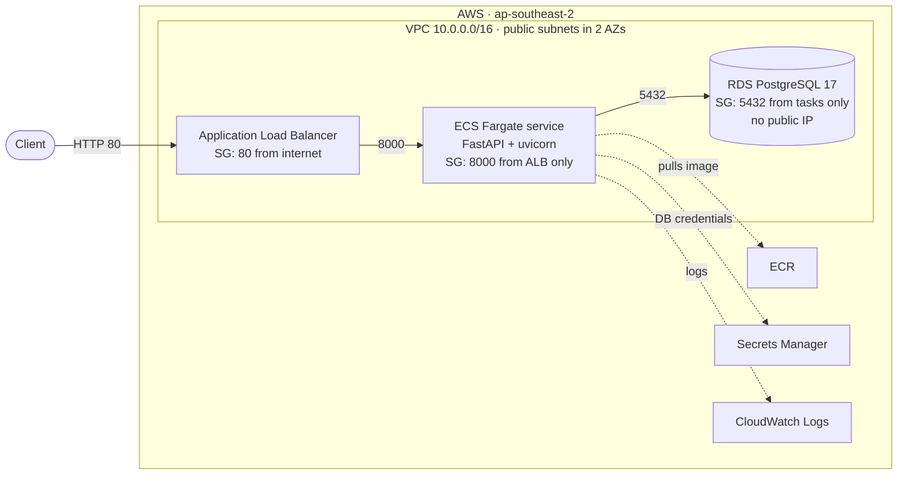

# payments-ledger

A double-entry payments ledger: accounts, transfers and balances. It is built with FastAPI and PostgreSQL and deployed to AWS (ECS Fargate, RDS, ALB) with Terraform.

The focus is **correctness under concurrency**:
- Two transfers racing on one account must never overdraw it.
- Every transfer's entries sum to zero.
- Recorded history can never be edited.

Each of these is enforced in code or in the database, and covered by tests that run against real Postgres.

**Stack:** Python 3.13 · FastAPI · SQLAlchemy Core + asyncpg · Alembic · PostgreSQL 17 · pytest + Testcontainers · mypy (strict) · ruff · Docker · Terraform · AWS

## Architecture



Inside the service:

```
api/      FastAPI routers + Pydantic schemas      shape of requests and responses
domain/   Money, Account, Transfer, Entry         business rules, pure Python, no I/O
ledger/   LedgerRepository (Protocol)             storage contract
            ├── InMemoryLedgerRepository          tests, local runs
            └── PostgresLedgerRepository          SQLAlchemy Core + asyncpg
```

## Design decisions

- **Money is an integer of minor units plus an ISO currency**, e.g. `{"amount_minor": 5000, "currency": "INR"}`. There are no floats anywhere, and mixing currencies raises an error.
- **Balances are derived, never stored.** A balance is the sum of the account's entries: one source of truth, nothing to drift.
- **Double entry.** Every transfer writes a debit and a matching credit in one transaction. The domain model refuses to build an unbalanced transfer.
- **Entries are append-only.** Postgres triggers reject `UPDATE`, `DELETE` and `TRUNCATE`. Mistakes are corrected with a new transfer.
- **The database enforces what it can.** Composite foreign keys make an entry's currency match its account and its transfer. `CHECK` constraints cover amounts and source ≠ destination.
- **Funds are checked at write time, under a row lock.** `save_transfer` locks the source account (`SELECT … FOR NO KEY UPDATE`), sums its entries and inserts, all in one transaction. There is no read-then-write race.

## Measured

| Experiment | Result |
|---|---|
| Two concurrent 80 withdrawals from a balance of 100, without a lock | both succeed → balance **−60** |
| Same, with the row lock | one succeeds, the other gets **409** |
| Opposite-direction transfers with `FOR UPDATE` | **10/10 deadlocks** (FK checks take `KEY SHARE` locks) |
| Same with `FOR NO KEY UPDATE` | **0 deadlocks** |
| Balance query on 1M entries, with vs without the `(account_id, created_at)` index | **0.59 ms** vs 44.8 ms |
| Docker image, naive vs multi-stage slim + non-root | 2.24 GB → **303 MB** (68 MB compressed) |

The concurrent-overdraft test first passed *without* any lock. The connection pool was cold, so the second request was still connecting when the first committed. The Postgres fixture now warms the pool, so the race actually happens.

## API

| Method | Path | |
|---|---|---|
| `POST` | `/accounts` | create an account |
| `GET` | `/accounts/{id}` | fetch an account |
| `GET` | `/accounts/{id}/balance` | current balance |
| `POST` | `/transfers` | move money between two accounts |
| `GET` | `/transfers/{id}` | a transfer with its entries |
| `GET` | `/health` | liveness only |

Errors: not found → **404**, insufficient funds → **409**, rule violations → **422**. Interactive docs are at `/docs`.

## Infrastructure

Terraform in `infra/`, split into three stacks with separate state, because they have different lifecycles:

| Stack | Contents | Lifecycle |
|---|---|---|
| `infra/bootstrap/` | S3 bucket for Terraform state (versioned, encrypted, private) | created once |
| `infra/ecr/` | ECR repository: immutable tags, scan on push, keeps the last 10 images | long-lived |
| `infra/` | VPC, subnets, security groups, RDS, IAM roles, ECS cluster, task definition, service, ALB | applied and destroyed freely |

- **Least-privilege networking.** Security groups reference each other, never IP ranges: ALB → task on 8000, task → RDS on 5432. RDS has no public IP.
- **No password in code or state.** RDS generates the master password and stores it in Secrets Manager. Terraform state holds only the secret's ARN. ECS injects the username and password at task start, and the app builds the URL with `URL.create`, which escapes special characters.
- **Two IAM roles.** The execution role may pull the image, write logs and read exactly one secret. The task role (what the app itself may call) has no permissions.
- **Reproducible images.** Tagged with the git commit, base images pinned by digest, immutable in ECR.
- **Liveness-only health check.** `/health` doesn't touch the database, so a DB outage can't make the ALB fail every task and ECS restart them in a loop.

**Deploy flow:**

1. Build and push the image, tagged with the short commit.
2. `terraform apply -var="image_tag=<commit>"` creates or updates the stack and registers a new task definition.
3. Run migrations as a one-off ECS task from the same image (`alembic upgrade head`).
4. The ECS service rolls out new tasks, and the ALB routes to them once `/health` passes.

**Cost.** When running, it costs about $1.5–2 a day, mostly the ALB, RDS and Fargate. The main stack is destroyed when not in use; ECR and the state bucket stay.

## Run locally

Requires [uv](https://docs.astral.sh/uv/) and Docker.

```bash
docker compose up -d --build
docker compose run --rm api alembic upgrade head
# → http://localhost:8000/docs
```

To run the app on the host against the Compose database instead:

```bash
docker compose up -d db
export DB_HOST=localhost DB_PORT=5433 DB_NAME=ledger DB_USER=ledger DB_PASSWORD=ledger
uv sync
uv run alembic upgrade head
uv run uvicorn payments.api.app:create_app --factory --reload
```

The app refuses to start if a required `DB_*` variable is missing, and the error names every missing one.

## Tests

```bash
uv run pytest                      # 75 tests; Docker must be running
uv run mypy src tests migrations   # strict
uv run ruff check .
```

- **Contract tests** run one suite against both repository implementations, including the race and deadlock cases.
- **Postgres tests** use Testcontainers: a real `postgres:17`, migrated with Alembic once per run.
- **API tests** go through the HTTP layer with `httpx.AsyncClient` and compare raw JSON, not the app's own models.

## Trade-offs and production gaps

Deliberate choices for a cost-capped deployment, and what I would change in production:

| Here | In production |
|---|---|
| Tasks in public subnets with public IPs, no NAT | private subnets + NAT gateway or VPC endpoints |
| Single-AZ RDS, no final snapshot | Multi-AZ, deletion protection, backups |
| HTTP on the ALB | HTTPS with an ACM certificate |
| Any client can create a `SYSTEM` account | seeded system accounts or an admin-only route |
| No authentication or rate limiting | auth at the edge, per-client limits |

## Roadmap

- Idempotency keys on `POST /transfers` (Redis)
- Transactional outbox for transfer events
- Metrics, tracing and CI
- Graceful shutdown and load testing

## License

MIT
